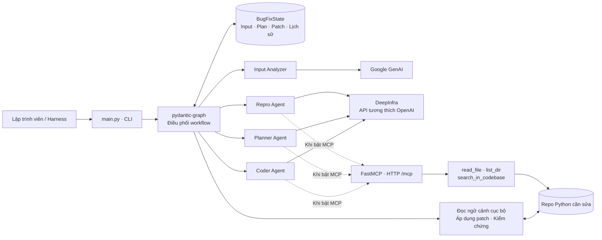
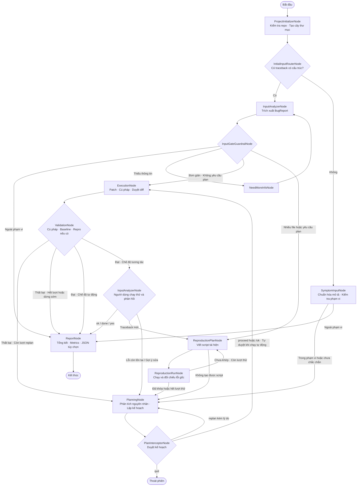
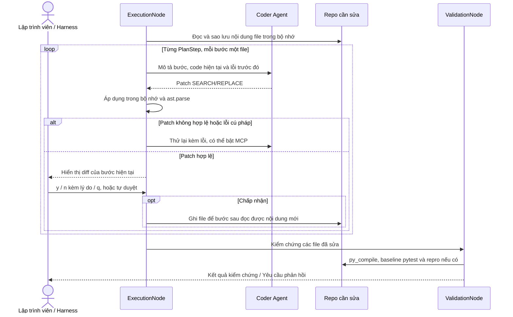

# PyFix-Agents

Hệ thống multi-agent hỗ trợ phân tích và sửa lỗi runtime Python, nhận đầu vào là **traceback** hoặc **mô tả hành vi lỗi**. PyFix dùng `pydantic-graph` để điều phối workflow, `pydantic-ai` để gọi LLM và MCP để bổ sung ngữ cảnh mã nguồn khi cần.

Ở chế độ tương tác, lập trình viên duyệt kế hoạch, xem diff từng bước và xác nhận kết quả chạy thử. Chế độ `--non-interactive` tự duyệt kế hoạch và bản vá, phục vụ harness đánh giá hoặc quy trình chạy tự động.

## Mục lục

- [Phạm vi hỗ trợ](#phạm-vi-hỗ-trợ)
- [Kiến trúc và vai trò agent](#kiến-trúc-và-vai-trò-agent)
- [Luồng xử lý lỗi](#luồng-xử-lý-lỗi)
- [Tạo và áp dụng bản vá](#tạo-và-áp-dụng-bản-vá)
- [Cài đặt và cấu hình](#cài-đặt-và-cấu-hình)
- [Chạy cục bộ](#chạy-cục-bộ)
- [Chạy bằng Docker](#chạy-bằng-docker)
- [Kiểm chứng và đầu ra](#kiểm-chứng-và-đầu-ra)
- [Tích hợp Bug Arena](#tích-hợp-bug-arena)
- [Cấu trúc mã nguồn](#cấu-trúc-mã-nguồn)
- [Quy ước commit](#quy-ước-commit)

## Phạm vi hỗ trợ

| Nhóm | Ví dụ | Cách xử lý |
| --- | --- | --- |
| Runtime do dữ liệu | `KeyError`, thiếu trường, `None`, sai kiểu | Phân tích payload và các giả định trong code |
| Runtime do logic | `IndexError`, điều kiện biên, retry hoặc trạng thái sai | Phân tích luồng điều khiển và file liên quan |
| Chưa phân loại chắc chắn | Mô tả hành vi bất thường chưa có traceback | Tiếp tục sang Planner với mức tin cậy thấp |
| Ngoài phạm vi hiện tại | API key, DNS, dependency, dịch vụ hoặc hạ tầng | Scope gate có thể từ chối và xuất báo cáo |

Phân luồng và kiểm tra phạm vi có sử dụng heuristic. Nên cung cấp thao tác gây lỗi, dữ liệu đầu vào, kết quả thực tế và kết quả mong muốn để agent khoanh vùng tốt hơn.

## Kiến trúc và vai trò agent



| Agent | Nhiệm vụ | Đầu ra | Cấu hình model |
| --- | --- | --- | --- |
| Input Analyzer | Trích xuất exception, stack, file và dữ liệu runtime | `BugReport` | `ANALYZER_MODEL_NAME` |
| Repro | Viết script tái hiện lỗi từ traceback | Nội dung `_pyfix_repro.py` | `REPRO_MODEL_NAME` |
| Planner | Đọc symptom và code, tìm nguyên nhân gốc, chia bước sửa | `PlanWrapper`: `root_cause`, `PlanStep[]` | `PLANNER_MODEL_NAME` |
| Coder | Chẩn đoán lỗi đơn giản hoặc sinh patch từng bước, mỗi bước nhắm một file | `BugExplanation` hoặc chuỗi patch | `CODER_MODEL_NAME` |

Tên model được khai báo trong [graph/config.py](graph/config.py). Analyzer dùng Google GenAI; ba agent còn lại dùng endpoint DeepInfra `https://api.deepinfra.com/v1/openai`.

Planner và Coder ưu tiên các đoạn code được thu thập cục bộ; chúng có thể bật MCP khi thiếu ngữ cảnh hoặc gặp lỗi tạo plan/patch. MCP server cung cấp thêm `write_file`, `run_linter`, `run_command`, nhưng toolset gắn với các agent hiện chỉ cho phép **ba tool đọc/tìm kiếm** trong sơ đồ. Các node Python chịu trách nhiệm ghi bản vá và kiểm chứng.

## Luồng xử lý lỗi

Sơ đồ thể hiện các nhánh chính trong [graph/nodes](graph/nodes), bao gồm hai loại đầu vào và vòng phản hồi sau kiểm chứng.



- Nhánh **symptom** đi thẳng sang Planner sau scope gate, không bắt buộc Repro trước.
- Nhánh **traceback đơn giản** đi thẳng sang Coder để chẩn đoán rồi xin tạo patch. Lỗi có nhiều file trong stack hoặc yêu cầu xem plan đi qua Repro và Planner.
- Repro thử tối đa **3 lượt chạy**, mỗi lượt timeout **10 giây**. Nếu không xác nhận được lỗi, workflow vẫn có thể tiếp tục lập kế hoạch.
- `proceed` hoặc `/ok` chấp nhận plan; `replan <lý do>` yêu cầu lập lại; `quit` thoát phiên. Sau kiểm chứng, nhập `ok`, `done` hoặc `yes` để kết thúc, hoặc cung cấp lỗi/gợi ý mới.

Sơ đồ rút gọn các nhánh lỗi API, fallback và retry nội bộ; xem các node để theo dõi từng trường hợp.

## Tạo và áp dụng bản vá

Coder trả patch dạng delimiter `SEARCH/REPLACE`, thay vì toàn bộ file hoặc vị trí số dòng:

Mỗi block bắt đầu bằng `<<<<<<< SEARCH`, chứa đoạn code cũ, phân cách bằng `=======`, rồi code thay thế và kết thúc bằng `>>>>>>> REPLACE`. Ví dụ, block có thể thay `payload["name"]` bằng `payload.get("name", "")` nếu yêu cầu ứng dụng cho phép giá trị mặc định.



Ở mỗi bước, `y` chấp nhận và ghi file, `n` yêu cầu tạo lại patch kèm lý do, `q` thoát và gọi rollback. Khi hết lượt retry trong execution, hệ thống cũng cố khôi phục các file đã ghi trong lượt execution đó. Rollback dùng bản sao trong bộ nhớ, không phải transaction Git và không tự hoàn tác mọi thay đổi sau khi validation thất bại.

## Cài đặt và cấu hình

Khuyến nghị **Python 3.12**, cùng phiên bản Docker image. Dependencies hiện chưa khóa phiên bản đầy đủ. Cần tài khoản Google GenAI cho Analyzer và API key DeepInfra cho các agent còn lại.

```bash
git clone https://github.com/hqcfmlno1/PyFix-Agents.git
cd PyFix-Agents
python3.12 -m venv .venv
source .venv/bin/activate
python -m pip install -r requirements.txt
cp .env.example .env
```

Trên Windows, kích hoạt virtualenv bằng `.venv\Scripts\activate`.

Điền thông tin xác thực vào `.env`:

```dotenv
GEMINI_API_KEY=your_google_api_key
DEEPSEEK_API_KEY=your_deepinfra_api_key
```

`GOOGLE_API_KEY` có thể thay cho `GEMINI_API_KEY`. Tên `DEEPSEEK_API_KEY` được giữ trong code nhưng giá trị hiện được gửi tới **DeepInfra**. Cả hai nhóm thông tin xác thực đều được kiểm tra ngay khi import cấu hình.

| Biến | Mặc định | Ý nghĩa |
| --- | --- | --- |
| `GEMINI_API_KEY` / `GOOGLE_API_KEY` | Bắt buộc một trong hai | Xác thực Google; ưu tiên `GEMINI_API_KEY` |
| `DEEPSEEK_API_KEY` | Bắt buộc | API key cho provider DeepInfra |
| `PYFIX_MCP_SERVER_HOST` | `127.0.0.1` | Host mà client kết nối tới MCP |
| `PYFIX_MCP_SERVER_PORT` | `8000` | Cổng mà client kết nối tới MCP |
| `PYFIX_PLANNER_USE_MCP` | `0` | `1` để Planner và Repro bắt đầu với MCP |
| `PYFIX_CODER_USE_MCP` | `0` | `1` để Coder bắt đầu với MCP ở chế độ tương tác |
| `PYFIX_NON_INTERACTIVE` | `0` | Cơ chế tự trả lời của tool `ask_human`; dùng `--non-interactive` để bật chế độ tự động cho toàn workflow |

Các cờ MCP là lựa chọn khởi đầu; fallback vẫn có thể bật MCP trong phiên. Khi đổi cổng, đặt `FASTMCP_PORT` cho tiến trình `mcp_server.py` và `PYFIX_MCP_SERVER_PORT` tương ứng cho client. `FASTMCP_HOST` cấu hình địa chỉ bind của server.

## Chạy cục bộ

### Chế độ tương tác

Terminal 1, tại thư mục PyFix-Agents và đã kích hoạt virtualenv:

```bash
python mcp_server.py
```

Terminal 2, cùng môi trường:

```bash
python main.py
```

Endpoint mặc định là `http://127.0.0.1:8000/mcp`. CLI yêu cầu đường dẫn repo rồi nhận traceback hoặc symptom; nhấn **Enter hai lần liên tiếp** để kết thúc nhập nhiều dòng. `main.py` không tự khởi động MCP server khi chạy cục bộ.

### Chế độ không tương tác

Giữ MCP server chạy để phục vụ fallback. Truyền đủ repo và symptom:

```bash
python main.py \
  --repo /absolute/path/to/buggy-repo \
  --symptom-file /absolute/path/to/symptom.txt \
  --report /absolute/path/to/output/report.json \
  --non-interactive
```

Hoặc truyền mô tả trực tiếp:

```bash
python main.py \
  --repo /absolute/path/to/buggy-repo \
  --symptom-text 'Hàm xử lý payload gây KeyError khi thiếu trường name.' \
  --non-interactive
```

| Tham số | Ý nghĩa |
| --- | --- |
| `--repo` | Thư mục repo cần sửa |
| `--symptom-file` | File UTF-8 chứa traceback hoặc mô tả lỗi |
| `--symptom-text` | Mô tả trực tiếp; nếu truyền cả hai nguồn, nội dung file được ưu tiên |
| `--report` | Ghi báo cáo JSON khi workflow tới `ReportNode` |
| `--non-interactive` | Tự duyệt plan/patch, kết thúc sau kiểm chứng |

CLI đặt `step_max_retries=5`, `max_replan_limit=2` khi tương tác; tương ứng **2** và **1** khi chạy tự động. Đây là các ngưỡng điều khiển workflow, tách biệt với retry gọi model và lượt chạy Repro.

## Chạy bằng Docker

```bash
docker build -t pyfix-agents .
```

`docker-entrypoint.sh` khởi động MCP server, chờ cổng sẵn sàng tối đa 15 giây rồi chạy CLI. Repo được mount có quyền ghi để áp dụng bản vá; mount output và log để giữ kết quả trên host.

```bash
mkdir -p output logs
docker run --rm \
  --env-file .env \
  -v /absolute/path/to/buggy-repo:/workspace/repo \
  -v /absolute/path/to/symptom.txt:/workspace/symptom.txt:ro \
  -v "$PWD/output:/workspace/output" \
  -v "$PWD/logs:/app/logs" \
  pyfix-agents main \
  --repo /workspace/repo \
  --symptom-file /workspace/symptom.txt \
  --report /workspace/output/report.json \
  --non-interactive
```

Image chỉ cài dependencies của PyFix. Với repo cần thư viện riêng, cài thêm chúng trong container; virtualenv trên host có thể không chạy được trong image Linux.

```bash
# CLI tương tác cùng MCP server
docker run --rm -it --env-file .env \
  -v /absolute/path/to/buggy-repo:/workspace/repo \
  pyfix-agents main --repo /workspace/repo

# Chỉ chạy MCP server, bind loopback trên host
docker run --rm -p 127.0.0.1:8000:8000 pyfix-agents server

# Mở shell trong image
docker run --rm -it pyfix-agents bash
```

## Kiểm chứng và đầu ra

`ValidationNode` thực hiện:

1. Chạy `py_compile` trên các file được ghi nhận trong `final_fixes`.
2. Nếu có `scenarios/test_baseline.py`, chạy đúng file này bằng `pytest`, timeout **30 giây**. Hiện chưa tự khám phá và chạy toàn bộ test suite.
3. Nếu script Repro đã được xác nhận và còn tồn tại, chạy lại với timeout **10 giây**, kiểm tra exit code bằng 0.
4. Khi các bước trên đạt, chế độ tự động xuất báo cáo; chế độ tương tác yêu cầu người dùng chạy thử và phản hồi.

Validation ưu tiên `<repo>/.venv/bin/python` nếu có; bước tái hiện lỗi ban đầu dùng interpreter đang chạy PyFix. Cần cài dependencies của repo và `pytest` trong môi trường được sử dụng nếu muốn chạy baseline.

Nếu thiếu baseline hoặc Repro hợp lệ, đạt kiểm chứng chủ yếu phản ánh cú pháp. Timeout/lỗi thực thi Repro trong validation hiện cũng có thể chỉ được ghi cảnh báo. Đọc log để biết những bước nào thực sự đã chạy.

| Đầu ra | Vị trí | Nội dung |
| --- | --- | --- |
| Session log | `logs/<timestamp>_<mode>_<bug_id>_pid<pid>.log` | stdout/stderr, lời gọi model và tool |
| Metrics | `pyfix_metrics.json` tại thư mục PyFix | Trạng thái, route, số replan, token/tool call theo agent, MCP fallback |
| Báo cáo harness | Đường dẫn `--report` | `reproduced`, `root_cause`, `fix_summary`, `initial_input_kind`, `bug_types`, `mcp_fallback_events` |
| Script tạm | `<repo>/_pyfix_repro.py` | Sinh trong nhánh Repro, dọn khi tới `ReportNode` |

`status` trong metrics có thể là `success`, `surrendered`, `incomplete`. Báo cáo `--report` chưa chứa `status`; `reproduced` có thể là `true` chỉ vì đã có input, nên không thay thế cho xác nhận script tái hiện thành công. CLI cũng chưa ánh xạ trạng thái sửa lỗi thất bại thành exit code riêng; harness nên đối chiếu metrics, log và kiểm thử repo.

## Tích hợp Bug Arena

[bug_arena_adapter.sh](bug_arena_adapter.sh) gọi Python trong `.venv` của PyFix và bật chế độ không tương tác. Khởi động MCP server trước khi gọi adapter.

```bash
ARENA_SYMPTOM_FILE=/absolute/path/to/symptom.txt \
ARENA_REPORT=/absolute/path/to/output/agent_report.json \
ARENA_BUG_ID=example-bug \
bash bug_arena_adapter.sh /absolute/path/to/buggy-repo
```

Adapter ưu tiên `ARENA_SYMPTOM_FILE` (mặc định `SYMPTOM.txt`); nếu file không tồn tại, dùng `ARENA_SYMPTOM`. `ARENA_REPORT` mặc định là `agent_report.json`. Đường dẫn tương đối tính từ thư mục đang gọi lệnh; `ARENA_BUG_ID` dùng để đặt tên log.

## Cấu trúc mã nguồn

```text
PyFix-Agents/
├── main.py                        # CLI, trạng thái ban đầu, session log
├── graph/
│   ├── __init__.py                # Đăng ký node, xây dựng graph
│   ├── config.py                  # Provider, model, endpoint, retry
│   ├── models.py                  # BugFixState và schema đầu ra
│   ├── agents.py                  # Agent, toolset, logging model/tool
│   ├── prompts.py                 # System prompt và mẫu phân tích
│   ├── helpers.py                 # Patch, diff, cây thư mục
│   └── nodes/
│       ├── project_init.py         # Kiểm tra repo
│       ├── initial_input_router.py # Nhận input, phân luồng
│       ├── symptom_input.py        # Symptom và scope gate
│       ├── input_analyzer.py       # Traceback và phản hồi
│       ├── input_guardrail.py      # Dữ liệu, độ phức tạp
│       ├── need_more_info.py       # Bổ sung thông tin
│       ├── reproduction_plan.py    # Sinh script tái hiện
│       ├── reproduction_run.py     # Xác nhận lỗi tái hiện
│       ├── planning.py             # Lập plan, MCP fallback
│       ├── plan_interceptor.py     # Duyệt / Lập lại plan
│       ├── execution.py            # Patch, duyệt diff, rollback
│       ├── validation.py           # Cú pháp, baseline, Repro
│       └── report.py               # Báo cáo, metrics, dọn script
├── mcp_server.py                  # FastMCP server đang sử dụng
├── mcp_client_old.py              # Client cũ để tham khảo
├── mcp_server_old.py              # Server cũ để tham khảo
├── test_input.py                  # Script thử gọi model, không phải test suite
├── bug_arena_adapter.sh           # Adapter cho harness
├── docker-entrypoint.sh           # Khởi động server và CLI
├── Dockerfile
├── requirements.txt
└── .env.example
```

Các sơ đồ Mermaid trong README mô tả workflow hiện tại và hiển thị trực tiếp trên GitHub. Ảnh trong `state-diagram/` là tài liệu lịch sử, có thể khác graph đang chạy.

## Quy ước commit

Sử dụng [Conventional Commits](https://www.conventionalcommits.org/en/v1.0.0/):

```text
type(scope): mô tả ngắn gọn thay đổi
```

| Type | Khi dùng | Ví dụ |
| --- | --- | --- |
| `feat` | Thêm khả năng mới | `feat(router): route symptoms and tracebacks separately` |
| `fix` | Sửa hành vi sai | `fix(validation): preserve runtime errors when replanning` |
| `docs` | Tài liệu | `docs(readme): refresh workflow diagrams and setup guide` |
| `refactor` | Đổi cấu trúc, giữ nguyên hành vi | `refactor(graph): simplify planning workflow` |
| `chore` | Cấu hình hoặc dọn file | `chore(git): ignore session logs` |
| `test` | Kiểm thử | `test(patches): cover ambiguous search blocks` |
| `build` | Dependencies hoặc build | `build(deps): add agent framework dependencies` |

Mỗi commit nên tập trung vào thay đổi cụ thể; tránh `big update` hoặc `update v2`. Dùng `!` hoặc footer `BREAKING CHANGE:` nếu thay đổi làm mất tương thích.
